# StepUp AI 코칭 — 최종 시안 16장

독립된 코칭 영역을 중심으로 한 정상 화면 4장과 시작·설정·오류·확인 상태 12장입니다. 러닝 중 화면은 이번 범위에서 다시 만들지 않았습니다. 모든 러닝 수치는 설명용 샘플입니다.

## 화면 연결

```text
첫 사용 동의 05 → 목표 설정 06 → 오늘 01 → 훈련 상세 02 → 기존 러닝 시작
                                  ↓
완료·저장된 기록 → 분석 03 → 목표 페이스 확인 16 → 사용자 확인 후 적용
                     ├─ 처리 중 07
                     ├─ 품질 부족 09
                     ├─ 오프라인 캐시 10
                     ├─ 실패 11
                     └─ 생성 한도 12

변화 04 → 다음 주 계획 13 → 사용자 확인 후 적용
설정 14 → AI 사용 해제 확인 15
분석 가능한 기록 없음 → 08
```

고정 상단·하단 UI는 기존 공용 구성요소를 재사용합니다. 코칭의 상위 진입 위치는 아직 확정되지 않았습니다. 모달이 열린 동안에는 뒤 화면과 하단 메뉴에 접근할 수 없어야 합니다.

## 목록

| 번호 | 화면 | 다음 동작 |
|---|---|---|
| 01 | [오늘의 코칭](mockup/01-coaching-home.jpg) | 훈련 선택 → 02 / 최근 기록 → 03 |
| 02 | [훈련 상세](mockup/02-coaching-workout-detail.jpg) | 이 훈련으로 시작 → 기존 러닝 시작 흐름 |
| 03 | [완료한 러닝 분석](mockup/03-coaching-run-analysis.jpg) | 기록 전환 / 다음 목표 선택 → 16 |
| 04 | [주간 변화](mockup/04-coaching-weekly-progress.jpg) | 주 이동 / 다음 주 계획 → 13 |
| 05 | [첫 사용 동의](mockup/05-ai-consent.jpg) | 체크 후 시작 → 06 / 나중에 → 기본 기능 |
| 06 | [코칭 목표 설정](mockup/06-coaching-preferences.jpg) | 선호 저장 → 01. 버튼을 눌러도 러닝 자동 시작 금지. |
| 07 | [분석 중](mockup/07-analysis-processing.jpg) | 이탈 가능, 완료되면 03. 서버 확인 대기는 별도 문구. |
| 08 | [기록 없음](mockup/08-no-running-records-v2.jpg) | 기존 러닝으로 이동 / 06 목표 설정 |
| 09 | [기록 품질 부족](mockup/09-data-quality-limited-v2.jpg) | 기본 기록 / GPS 도움말 |
| 10 | [오프라인 저장 분석](mockup/10-offline-cached-analysis.jpg) | 캐시 확인. 새 생성은 연결 후 정책에 따라. |
| 11 | [분석 실패와 재시도](mockup/11-analysis-failed.jpg) | 같은 작업 재시도 / 기본 기록 보기 |
| 12 | [AI 이용 한도](mockup/12-analysis-limit.jpg) | 저장 분석 확인 / 기본 기록 사용 |
| 13 | [주간 계획 검토](mockup/13-week-plan-review.jpg) | 계획 적용 / 나중에 |
| 14 | [AI 코칭 설정](mockup/14-ai-coaching-settings.jpg) | 자동 분석·주간 리포트 / 목표 / 해제 → 15 |
| 15 | [동의 철회 확인](mockup/15-consent-withdrawal.jpg) | 계속 사용 / 해제. 분석 삭제는 별도 미선택 항목. |
| 16 | [목표 페이스 적용 확인](mockup/16-pace-apply-confirmation-v2.jpg) | 목표 적용 / 취소. 자동 러닝 시작 금지. |

## 화면별 미리보기

### 01 오늘의 코칭

오늘 할 훈련과 최근 분석을 한눈에 확인.

- 동작: 훈련 선택 → 02 / 최근 기록 → 03
- AI 경계: 허용된 추천의 이유만 AI. 날짜·완료 체크·최근 숫자는 코드.

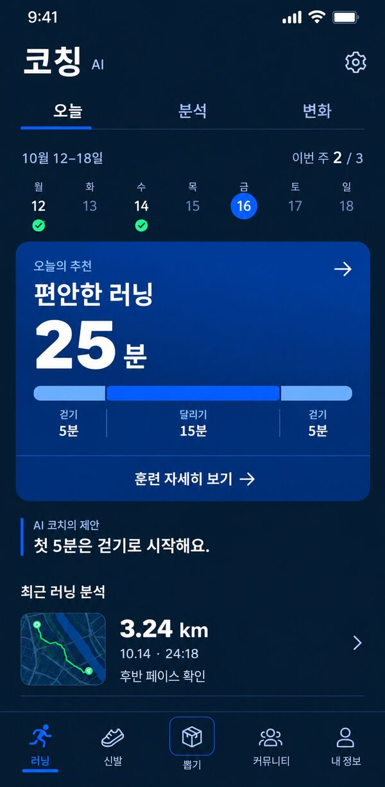

### 02 훈련 상세

추천된 훈련의 단계와 시간을 확인.

- 동작: 이 훈련으로 시작 → 기존 러닝 시작 흐름
- AI 경계: 시간·순서·강도는 검토된 템플릿. AI는 짧은 이유.

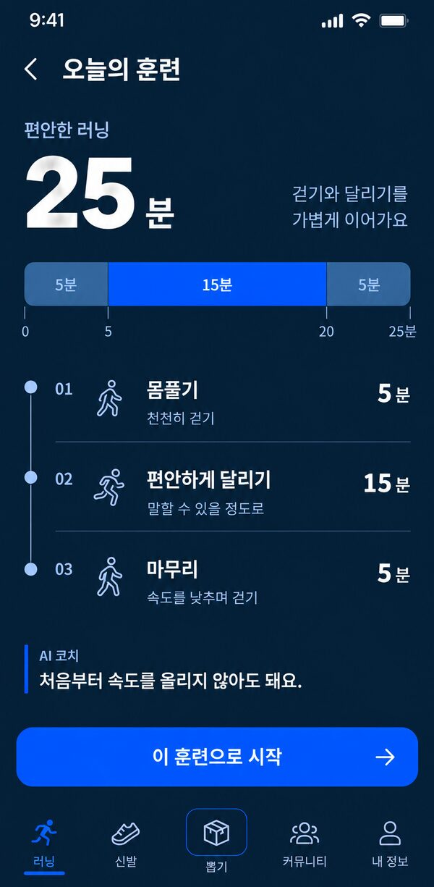

### 03 완료한 러닝 분석

러닝 저장과 검증 이후의 기록 분석. 종료창이 아님.

- 동작: 기록 전환 / 다음 목표 선택 → 16
- AI 경계: 숫자·그래프는 계산, AI는 근거에 연결된 설명.

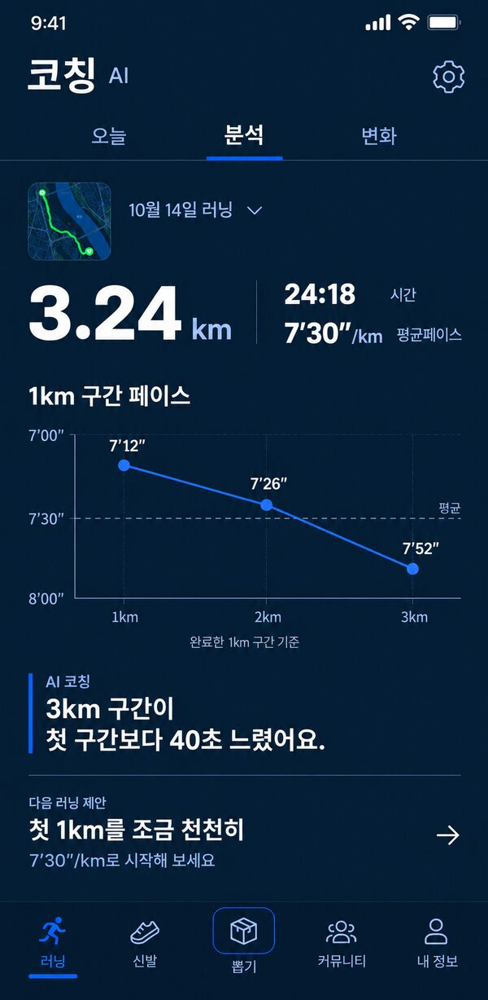

### 04 주간 변화

선택한 주의 실제 기록과 변화 확인.

- 동작: 주 이동 / 다음 주 계획 → 13
- AI 경계: 집계는 계산, AI는 주간 요약과 허용 계획의 추천 이유.

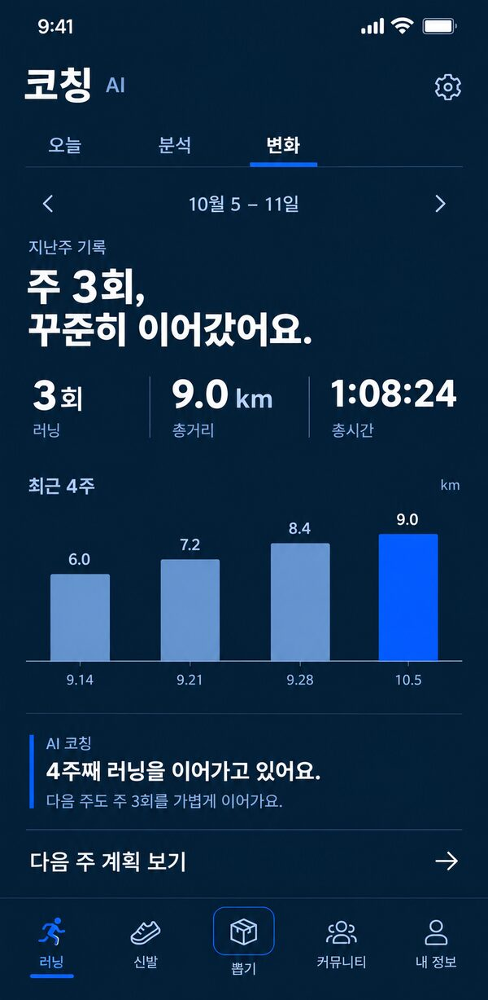

### 05 첫 사용 동의

첫 사용 전, 보낼 정보와 기능을 설명.

- 동작: 체크 후 시작 → 06 / 나중에 → 기본 기능
- AI 경계: 동의 UI·문구에는 AI 호출 없음.

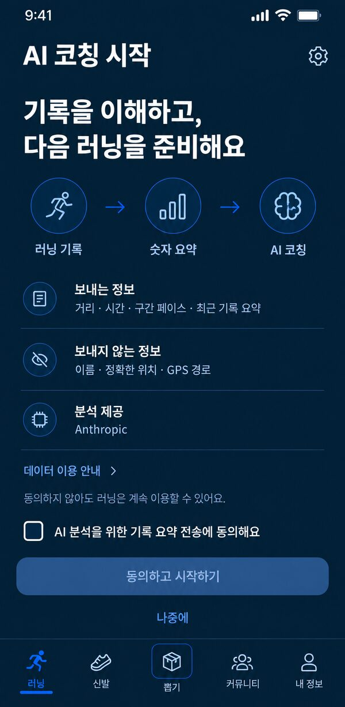

### 06 코칭 목표 설정

목표·주간 횟수·선호 시간을 선택.

- 동작: 선호 저장 → 01. 버튼을 눌러도 러닝 자동 시작 금지.
- AI 경계: 설정 저장에는 AI 호출 없음.

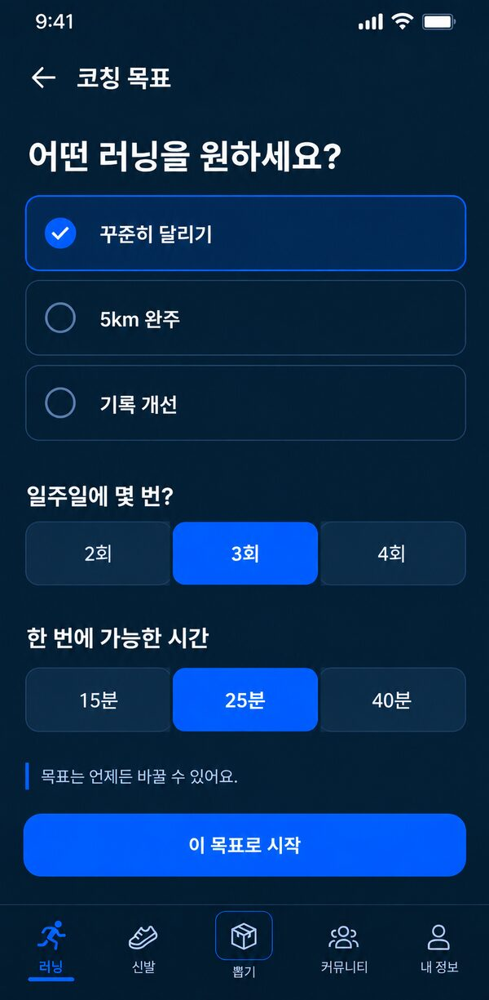

### 07 분석 중

기본 기록은 준비됐고 AI 작업만 진행 중.

- 동작: 이탈 가능, 완료되면 03. 서버 확인 대기는 별도 문구.
- AI 경계: 진행 중인 job만 추적, 화면 재진입으로 재생성 금지.

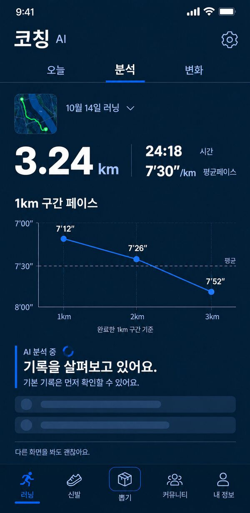

### 08 기록 없음

분석 가능한 기록이 없는 사용자.

- 동작: 기존 러닝으로 이동 / 06 목표 설정
- AI 경계: 외부 호출 없음. 예시 지도는 장식이며 실제 경로 아님.

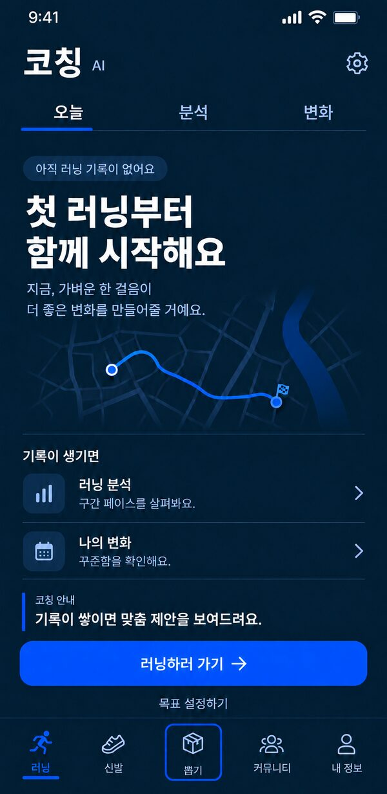

### 09 기록 품질 부족

GPS·구간 근거가 부족하여 분석을 생략.

- 동작: 기본 기록 / GPS 도움말
- AI 경계: 외부 호출 없음. 없는 그래프·거리·페이스를 채우지 않음.

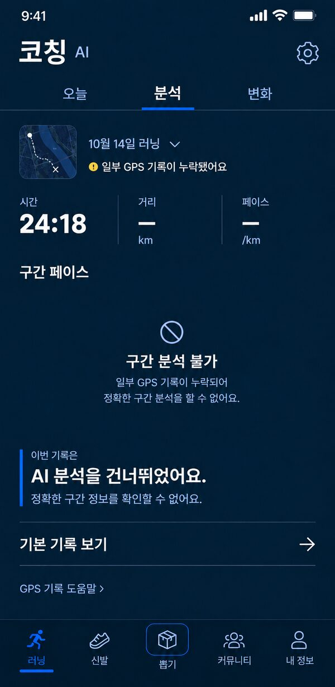

### 10 오프라인 저장 분석

오프라인이지만 같은 기록의 분석 캐시가 있음.

- 동작: 캐시 확인. 새 생성은 연결 후 정책에 따라.
- AI 경계: 새 AI 호출 없음, 저장 시각 명시.

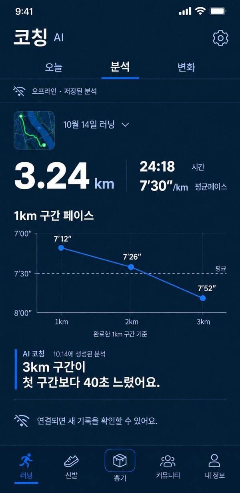

### 11 분석 실패와 재시도

기본 기록은 정상이고 AI만 실패.

- 동작: 같은 작업 재시도 / 기본 기록 보기
- AI 경계: 한도 내 제한된 재시도만.

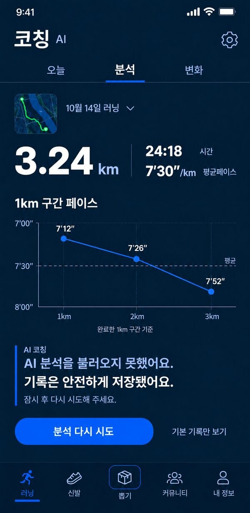

### 12 AI 이용 한도

새 분석 생성 한도에 도달.

- 동작: 저장 분석 확인 / 기본 기록 사용
- AI 경계: 신규 호출 차단, 무료·유료 정책 발명 금지.

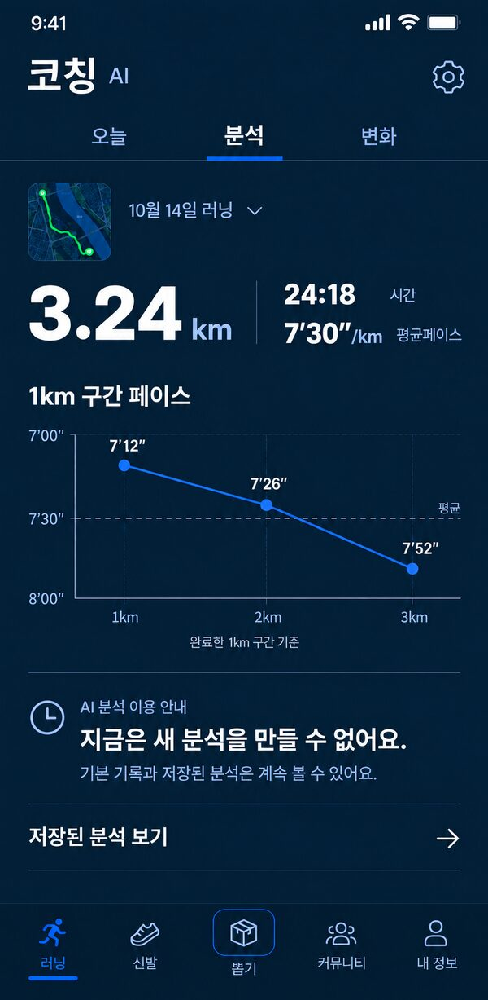

### 13 주간 계획 검토

아직 적용되지 않은 다음 주 계획 검토.

- 동작: 계획 적용 / 나중에
- AI 경계: 생성된 허용 계획을 보여줌. 적용 동작은 AI 아님.

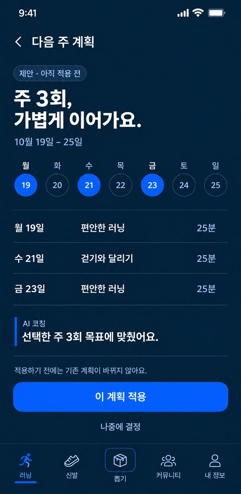

### 14 AI 코칭 설정

동의 이후의 AI 기능과 선호 제어.

- 동작: 자동 분석·주간 리포트 / 목표 / 해제 → 15
- AI 경계: 설정 UI에는 AI 호출 없음. 생성 토글과 푸시 권한 분리.

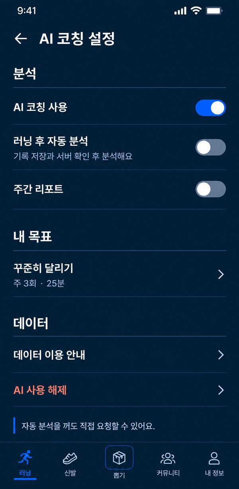

### 15 동의 철회 확인

AI 기능 해제를 확정하는 모달.

- 동작: 계속 사용 / 해제. 분석 삭제는 별도 미선택 항목.
- AI 경계: 대기 작업 취소, 외부 전송 이후의 즉시 삭제 보장 금지.

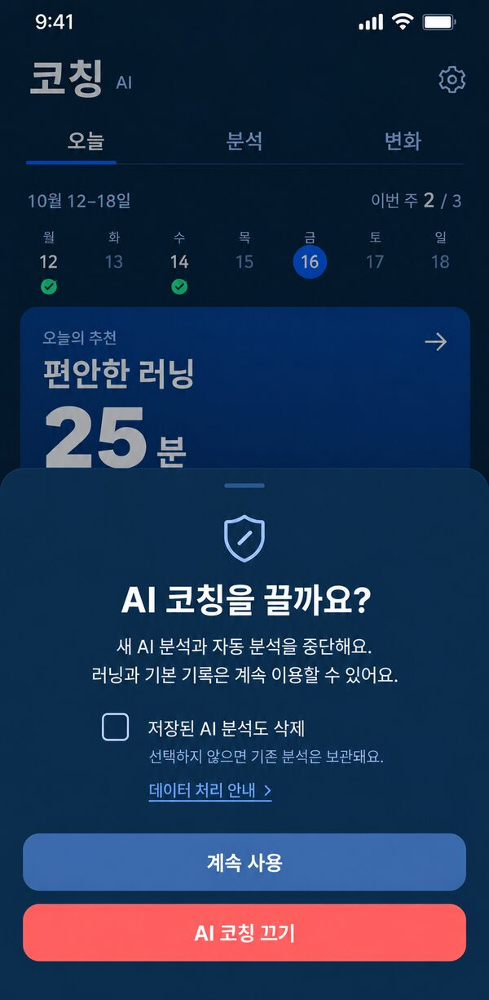

### 16 목표 페이스 적용 확인

AI 제안에서 사용자가 다음 목표를 선택.

- 동작: 목표 적용 / 취소. 자동 러닝 시작 금지.
- AI 경계: 검증된 후보 수치 적용. 적용 시 새 AI 호출 없음.

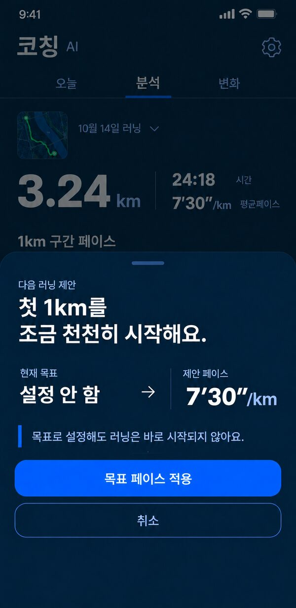

## 구현할 때 우선할 것

- 최종 파일은 이 문서에 연결된 16장입니다. 08·09·16은 검수 수정본을 사용합니다.
- 시안은 픽셀 단위 구현 사양이 아닙니다. 의도치 않은 글자·간격·아이콘 차이보다 `CLAUDE-HANDOFF.md`의 동작과 기존 공유 UI가 우선합니다.
- 05의 동의 문구는 초안입니다. 06의 목표 저장은 러닝 시작이 아닙니다. 13·16의 제안은 확인 전까지 미적용입니다.
- 분석 실패·오프라인이어도 원본 러닝 기록과 기본 숫자는 유지합니다.
- 서버 확인 대기, 캐시 없는 오프라인, 입력 변경 후 오래된 분석은 동일한 상태 양식에 맞는 문구로 처리합니다. 없는 숫자나 완료 체크를 만들어 넣지 않습니다.
- 목표·계획 저장 중에는 적용 버튼 중복 입력을 막고, 저장 실패 시 기존 목표를 유지합니다. 성공 여부를 확인하기 전에 성공 문구를 표시하지 않습니다.

